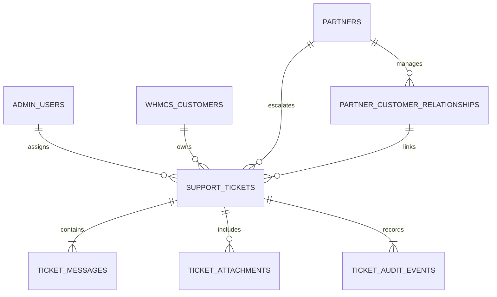

# Unified Cloud System Architecture

## 1. Overview & High-Level Architecture

Unified Cloud is an enterprise cloud infrastructure platform built with a high-performance vanilla JavaScript and Node.js architecture. The platform operates without heavy frontend bundlers, maintaining ultra-fast load times, clear separation of concerns, and native browser standards.

```
Unified Cloud Platform
 ├── Public Cloud Website (index.html)
 │    ├── 3D WebGL Datacenter Flight Journey (Three.js r128 + Meshopt)
 │    ├── Dynamic Service Catalogues & Calculators (assets/js/modules/dynamic-services.js)
 │    ├── Dhaka Anycast Domain Engine (assets/js/modules/domain-search.js)
 │    └── Universal Support Ticket Entry & Modal (assets/js/modules/support-ticket.js)
 ├── Cloud Partner Portal (partners.html, partner-dashboard.html, admin-partners.html)
 │    ├── Spend-Based Tier Engine & Wholesale Margins (5% - 25%)
 │    ├── Reseller-to-Buyer Customer Relationship Management
 │    └── Reseller Ticket Desk (triage, reply, escalate to Platform NOC)
 ├── Centralized Admin Portal (admin.html)
 │    ├── Multi-zone Infrastructure & NOC Incidents (Dhaka DC-01, Singapore SG-01)
 │    ├── Live Financials, MRR & Justified Refund Approval
 │    ├── RBAC Matrix (8 specialized administrative roles)
 │    └── Unified Support Management Workspace (8 live KPIs, triage, internal notes, SLA)
 └── Node.js Microservices Backend (server/)
      ├── server.mjs                → Virtual host router, static server & API dispatcher
      ├── api.mjs                   → REST API routing & RBAC middleware guards
      ├── tickets-service.mjs       → Ticketing domain engine, SLA calculation, multi-tenant isolation
      ├── db.mjs                    → Native SQLite persistence, schema migrations & relations
      ├── auth.mjs                  → SessionStore, token revocation & brute-force lockout
      ├── pricing-engine.mjs        → Automated wholesale pricing & tier transitions
      ├── reward-service.mjs        → Commission & reward point ledger
      ├── whmcs-adapter.mjs         → WHMCS enterprise billing & invoice lifecycle
      └── cloudstack-adapter.mjs    → Apache CloudStack multi-zone VM provisioning
```

---

## 2. Frontend Script Loading & Execution Order

All modules are loaded in strict sequence to respect DOM element dependencies and shared registries.

| # | File | Purpose | Scope / Dependencies |
|---|---|---|---|
| 1 | `assets/js/vendor/three.min.js` | WebGL 3D 3rd-party runtime | Global `THREE` |
| 2 | `assets/js/vendor/GLTFLoader.js` | glTF / GLB model loader | `THREE.GLTFLoader` |
| 3 | `assets/js/vendor/meshopt_decoder.js` | Meshopt geometry decoder | `MeshoptDecoder` |
| 4 | `assets/js/config.js` | Base configuration & endpoints | `window.UNIFIED_CONFIG` |
| 5 | `assets/js/data/service-pages.js` | Service catalog schemas & pricing specs | `window.SERVICE_PAGES` |
| 6 | `assets/js/data/digicert-prices.js` | DigiCert SSL tier pricing registry | `window.DIGICERT_PRICES` |
| 7 | `assets/js/data/comodo-prices.js` | Comodo/Sectigo SSL tier pricing | `window.COMODO_PRICES` |
| 8 | `assets/js/modules/flight-scene.js` | WebGL volumetric scene & scroll driver | Publishes `window.__sm` |
| 9 | `assets/js/modules/services-gallery.js`| 3D services carousel & cards | Reads `window.__sm` |
| 10 | `assets/js/modules/latency-widget.js` | BDIX & global edge telemetry | Edge ping measurements |
| 11 | `assets/js/modules/about-page.js` | Company profile & datacenter specs | `#aboutOverlay` |
| 12 | `assets/js/modules/header-nav.js` | Navigation bar, mega menus & search | Desktop & mobile header |
| 13 | `assets/js/modules/partner-page.js` | Partner application form handler | Multi-step validation |
| 14 | `assets/js/modules/hosting-overlays.js`| Web hosting & cPanel configurators | Hosting modal logic |
| 15 | `assets/js/modules/service-modal.js` | Dynamic product detail drawers | Cart integration |
| 16 | `assets/js/modules/dynamic-services.js`| Dynamic service page generator | Shared footer `window.__UF` |
| 17 | `assets/js/modules/ssl-configurator.js`| SSL order matrix & SAN calculator | Cart checkout |
| 18 | `assets/js/modules/digicert-catalog.js`| DigiCert modal catalog viewer | Product filters |
| 19 | `assets/js/modules/comodo-catalog.js` | Sectigo modal catalog viewer | Product filters |
| 20 | `assets/js/modules/vps-matrix.js` | Cloud VPS compute configurator | Spec sliders & pricing |
| 21 | `assets/js/modules/storage-calc.js` | S3-compatible cloud storage calculator| TB/Bandwidth slider |
| 22 | `assets/js/modules/ui-toggles.js` | Billing period switcher (Monthly/Yearly)| Dynamic attribute toggler |
| 23 | `assets/js/modules/support-ticket.js` | Universal ticket modal & guest lookup | `window.openSupportTicketModal` |
| 24 | `assets/js/app.js` | Application bootstrap & router | Final initialization |

---

## 3. Database Architecture & Schema Relationships

The persistence layer is managed by Node.js native SQLite (`server/db.mjs`) with foreign key constraints, indexes, and automated schema migrations.



### Table Definitions

1. **`support_tickets`**
   - `id` (INTEGER PRIMARY KEY)
   - `ticket_number` (TEXT UNIQUE) — Human-readable format: `TCK-YYYY-XXXXX`
   - `subject` (TEXT NOT NULL), `description` (TEXT NOT NULL)
   - `category` (TEXT) — Billing, Technical, Infrastructure, Domain, Partner, Other
   - `priority` (TEXT) — `LOW`, `NORMAL`, `HIGH`, `CRITICAL`
   - `status` (TEXT) — `OPEN`, `ASSIGNED`, `IN_PROGRESS`, `WAITING_BUYER`, `WAITING_RESELLER`, `ESCALATED`, `RESOLVED`, `CLOSED`
   - `customer_id` (INTEGER, FK to `whmcs_customers`)
   - `partner_id` (INTEGER, FK to `partners`)
   - `buyer_name` (TEXT), `buyer_email` (TEXT), `buyer_phone` (TEXT)
   - `assigned_to` (INTEGER, FK to `admin_users`)
   - `related_service_id`, `related_order_id`, `related_product_code`
   - `preferred_contact` (TEXT) — `EMAIL`, `PHONE`, `PORTAL`
   - `is_escalated` (INTEGER DEFAULT 0)
   - `escalated_at` (DATETIME), `escalated_by` (TEXT), `escalation_reason` (TEXT)
   - `sla_due_at` (DATETIME)
   - `resolved_at` (DATETIME), `closed_at` (DATETIME)
   - `created_at` (DATETIME), `updated_at` (DATETIME)

2. **`ticket_messages`**
   - `id` (INTEGER PRIMARY KEY)
   - `ticket_id` (INTEGER NOT NULL, FK to `support_tickets`)
   - `author_id` (INTEGER), `author_name` (TEXT), `author_email` (TEXT)
   - `author_role` (TEXT) — `CUSTOMER`, `PARTNER`, `ADMIN`, `SUPPORT_AGENT`, `SYSTEM`
   - `message` (TEXT NOT NULL)
   - `is_internal` (INTEGER DEFAULT 0) — Masked from non-admin roles
   - `created_at` (DATETIME)

3. **`ticket_attachments`**
   - `id` (INTEGER PRIMARY KEY)
   - `ticket_id` (INTEGER, FK to `support_tickets`), `message_id` (INTEGER)
   - `original_name` (TEXT), `file_path` (TEXT), `file_size` (INTEGER), `mime_type` (TEXT)
   - `uploaded_by` (TEXT), `created_at` (DATETIME)

4. **`ticket_audit_events`**
   - `id` (INTEGER PRIMARY KEY)
   - `ticket_id` (INTEGER NOT NULL)
   - `action` (TEXT), `event_type` (TEXT)
   - `actor_id` (INTEGER), `actor_name` (TEXT), `actor_role` (TEXT)
   - `old_state` (TEXT JSON), `new_state` (TEXT JSON)
   - `notes` (TEXT), `created_at` (DATETIME)

---

## 4. Ticketing Lifecycle & State Transitions

Permitted status transitions are strictly enforced in `server/tickets-service.mjs`:

```
   ┌─────────┐
   │  OPEN   │
   └────┬────┘
        │
   ┌────▼────────┐       Assign Agent       ┌──────────────┐
   │ IN_PROGRESS │ ───────────────────────► │   ASSIGNED   │
   └────┬────────┘                          └──────┬───────┘
        │                                          │
        ├──────────────────┬───────────────────────┤
        │                  │                       │
   ┌────▼───────────┐ ┌────▼─────────────┐   ┌─────▼────────┐
   │ WAITING_BUYER  │ │ WAITING_RESELLER │   │  ESCALATED   │ (To NOC Admin)
   └────┬───────────┘ └────┬─────────────┘   └─────┬────────┘
        │                  │                       │
        └──────────────────┼───────────────────────┘
                           │
                     ┌─────▼──────┐
                     │  RESOLVED  │
                     └─────┬──────┘
                           │
                     ┌─────▼──────┐
                     │   CLOSED   │
                     └────────────┘
```

### SLA Calculation Policy
- **Critical (`CRITICAL`)**: 2 Hours target SLA
- **High (`HIGH`)**: 4 Hours target SLA
- **Normal (`NORMAL`)**: 12 Hours target SLA
- **Low (`LOW`)**: 24 Hours target SLA

---

## 5. Security & Multi-Tenant Isolation Architecture

1. **Strict Reseller Tenant Isolation**:
   - Resellers can only query tickets where `partner_id == actor.partnerId`.
   - Any attempt to read or modify another reseller's ticket triggers an immediate `Tenant access violation (403 Forbidden)`.
2. **Private Administrative Notes Isolation**:
   - Support staff can flag replies as internal (`is_internal: 1`).
   - The query projection in `getTicketDetails()` strictly strips internal messages whenever the requesting actor is a `CUSTOMER` or `PARTNER`.
3. **Insecure Direct Object Reference (IDOR) Protection**:
   - Guests cannot view tickets simply by knowing a ticket ID or reference number.
   - Lookups require both the human-readable `ticket_number` and the verified `buyer_email`. Mismatched requests return `404 Not Found`.
4. **Attachment Security**:
   - File uploads are checked against an extension allowlist (`png`, `jpg`, `jpeg`, `pdf`, `txt`, `log`, `zip`, `gz`). Executables (`.exe`, `.sh`, `.bat`, `.js`, `.py`) are rejected.
   - Max file size: 10MB per attachment.
5. **Rate Limiting**:
   - IP-based rate limiting on ticket creation and public replies prevents spam and denial-of-service abuse.

---

## 6. Public Website Entry Point Rules

To preserve brand identity and visual aesthetics:
- **Included Entry Points**:
  - `partners.html` (header navigation link + footer links).
  - All dynamic service catalog pages (`dynamic-services.js` shared footer `window.__UF` support trigger).
- **Explicitly Excluded**:
  - Homepage (`index.html`) root 3D scene layers (`#`, `#a`, `#b`, `#c`).
  - Legacy introductory page (`Fly into the future.html`).

---

## 7. Automated Testing Architecture

Testing is executed natively using Node.js Test Runner (`node --test`), verifying 92 tests across 3 comprehensive test suites:

- **`tests/partner-system.test.mjs`** (33 tests): Partner tiers, commissions, spend progression, and wholesale discounting.
- **`tests/admin-portal.test.mjs`** (33 tests): RBAC matrix, CloudStack VM ops, WHMCS financial refunds, and security audit logs.
- **`tests/support-ticketing.test.mjs`** (26 tests):
  1. Public ticket submission, validation, SLA, and guest lookup.
  2. Reseller-to-buyer workflow, buyer ticket creation, and tenant isolation.
  3. Centralized admin visibility, staff assignment, and internal note masking.
  4. Attachment security, extension filtering, and status validation.
  5. Public website entry points and homepage exclusion enforcement.
