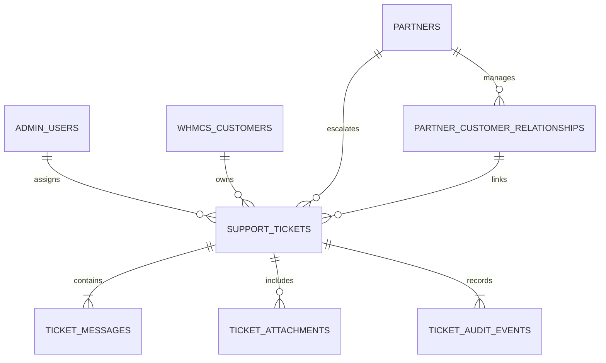

# Unified Cloud System Architecture

## 1. Overview & High-Level Architecture

Unified Cloud is an enterprise cloud infrastructure platform built with a high-performance vanilla JavaScript and Node.js architecture. The platform operates without heavy frontend bundlers, maintaining ultra-fast load times, clear separation of concerns, and native browser standards.

**Actual stack (verified from the source):**

| Layer | Technology |
|---|---|
| Public site | Static multi-page HTML + classic (non-module) browser scripts; Three.js r128 (`assets/js/vendor/three.min.js`), GLTFLoader + Meshopt decoder, anime.js 4.0.2 (`assets/js/vendor/anime.umd.min.js`, vendored; the former CDN URL returned 404) |
| Framework | **None.** No React or Next.js. Routing is hash-based inside `index.html`, plus separate HTML pages served by the Node server |
| Build | Vite 6 (`vite.config.mjs`): copies `assets/` and emits the five HTML entry pages to `dist/`. Classic scripts are not bundled |
| Backend | Node.js ≥ 22.5 (`node:http`, `node:sqlite` `DatabaseSync`), no web framework |
| Database | SQLite file `data/partner-system.db` (git-ignored) |
| Tests | Node test runner (`node --test`); browser tests with `playwright-core` driving an installed Chrome or Edge |
| Deployment (as configured in the repo) | `docker-compose.yml` (Node 22 container + nginx proxy), or `caddy/Caddyfile`. No CI deploy pipeline. The only GitHub workflow refreshes SSL prices |

```
Unified Cloud Platform
 ├── Public Cloud Website (index.html)
 │    ├── 3D WebGL Datacenter Flight Journey (Three.js r128 + Meshopt)
 │    ├── Dynamic Service Catalogues & Calculators (assets/js/modules/dynamic-services.js)
 │    ├── Dhaka Anycast Domain Engine (assets/js/modules/domain-search.js)
 │    ├── Universal Shopping Cart & Taka System (assets/js/modules/universal-cart.js)
 │    └── Universal Support Ticket Entry & Modal (assets/js/modules/support-ticket.js)
 ├── Cloud Partner Portal (partners.html, partner-dashboard.html, admin-partners.html)
 │    ├── Spend-Based Tier Engine & Wholesale Margins (5% - 25%)
 │    ├── Reseller-to-Buyer Customer Relationship Management
 │    └── Reseller Ticket Desk (triage, reply, escalate to Platform NOC)
 ├── Centralized Admin Portal (admin.html)
 │    ├── Multi-zone Infrastructure & NOC Incidents (Dhaka DC-01, Singapore SG-01)
 │    ├── Live Financials, MRR & Justified Refund Approval
 │    ├── RBAC Matrix (8 specialized administrative roles)
 │    └── Unified Support Management Workspace (8 live KPIs, triage, internal notes, SLA)
 └── Node.js Microservices Backend (server/)
      ├── server.mjs                → Virtual host router, static server & API dispatcher
      ├── api.mjs                   → REST API routing & RBAC middleware guards
      ├── tickets-service.mjs       → Ticketing domain engine, SLA calculation, multi-tenant isolation
      ├── db.mjs                    → Native SQLite persistence, schema migrations & relations
      ├── auth.mjs                  → SessionStore, token revocation & brute-force lockout
      ├── pricing-engine.mjs        → Automated wholesale pricing & tier transitions
      ├── reward-service.mjs        → Commission & reward point ledger
      ├── whmcs-adapter.mjs         → WHMCS enterprise billing & invoice lifecycle
      ├── agentic-ai.mjs            → Agentic AI pricing, RAG billing, WHMCS orders, verified activation, usage
      ├── agentic-forms.mjs         → Agentic AI form specifications and server-side validation
      ├── agentic-requests.mjs      → Customized/Branded quotation workflow and payment verification
      ├── mailer.mjs                → SMTP client and persistent email outbox
      └── cloudstack-adapter.mjs    → Apache CloudStack multi-zone VM provisioning
```

---

## 2. Frontend Script Loading & Execution Order

All modules are loaded in strict sequence to respect DOM element dependencies and shared registries.

| # | File | Purpose | Scope / Dependencies |
|---|---|---|---|
| 0 | `assets/js/csp-handlers.js` (in `<head>`) | Runs `data-onclick` / `-onsubmit` / `-onchange` / `-oninput`, `data-click-target`, `data-hide-on-error` | Delegated on `document`; parses calls, never `eval` |
| 1 | `assets/js/vendor/three.min.js` | WebGL 3D 3rd-party runtime | Global `THREE` |
| 2 | `assets/js/vendor/GLTFLoader.js` | glTF / GLB model loader | `THREE.GLTFLoader` |
| 3 | `assets/js/vendor/meshopt_decoder.js` | Meshopt geometry decoder | `MeshoptDecoder` |
| 3a | `assets/js/vendor/anime.umd.min.js` | anime.js 4.0.2 tweening (services gallery pulse/burst) | Global `anime` |
| 4 | `assets/js/config.js` | Base configuration & endpoints | `window.UNIFIED_CONFIG` |
| 5 | `assets/js/data/service-pages.js` | Service catalog schemas & pricing specs | `window.SERVICE_PAGES` |
| 6 | `assets/js/data/digicert-prices.js` | DigiCert SSL tier pricing registry | `window.DIGICERT_PRICES` |
| 7 | `assets/js/data/comodo-prices.js` | Comodo/Sectigo SSL tier pricing | `window.COMODO_PRICES` |
| 8 | `assets/js/modules/webgl-perf.js` | Dynamic hardware GPU tier detection | Quality scaling |
| 9 | `assets/js/modules/flight-scene.js` | WebGL volumetric scene & scroll driver | Publishes `window.__sm` |
| 10 | `assets/js/modules/services-gallery.js`| 3D services carousel & cards | Reads `window.__sm` |
| 11 | `assets/js/modules/latency-widget.js` | BDIX & global edge telemetry | Edge ping measurements |
| 12 | `assets/js/modules/about-page.js` | Company profile & datacenter specs | `#aboutOverlay` |
| 13 | `assets/js/modules/header-nav.js` | Navigation bar, mega menus & search | Desktop & mobile header |
| 14 | `assets/js/modules/partner-page.js` | Partner application form handler | Multi-step validation |
| 15 | `assets/js/modules/hosting-overlays.js`| Web hosting & cPanel configurators | Hosting modal logic |
| 16 | `assets/js/modules/service-modal.js` | Dynamic product detail drawers | Cart integration |
| 17 | `assets/js/modules/dynamic-services.js`| Dynamic service page generator | Shared footer `window.__UF` |
| 18 | `assets/js/modules/universal-cart.js` | Cart dropdown flyout, drawer, BDT engine | `window.UnifiedCart` |
| 19 | `assets/js/modules/ssl-configurator.js`| SSL order matrix & SAN calculator | Cart checkout |
| 20 | `assets/js/modules/digicert-catalog.js`| DigiCert modal catalog viewer | Product filters |
| 21 | `assets/js/modules/comodo-catalog.js` | Sectigo modal catalog viewer | Product filters |
| 22 | `assets/js/modules/vps-matrix.js` | Cloud VPS compute configurator | Spec sliders & pricing |
| 23 | `assets/js/modules/storage-calc.js` | S3-compatible cloud storage calculator| TB/Bandwidth slider |
| 24 | `assets/js/modules/domain-search.js` | Real-time Dhaka Anycast domain search | Instant cart addition |
| 25 | `assets/js/modules/ui-toggles.js` | Billing period switcher (Monthly/Yearly)| Dynamic attribute toggler |
| 26 | `assets/js/modules/support-ticket.js` | Universal ticket modal & guest lookup | `window.openSupportTicketModal` |
| 26a | `assets/js/modules/agentic-common.js` | Shared helpers for the Agentic AI pages | `window.AGX` |
| 26b | `assets/js/modules/agentic-checkout.js` | Ready-Made AI and Chat-Only AI pages | `[data-agx="READY_MADE"/"CHAT_ONLY"]` |
| 26c | `assets/js/modules/agentic-requests.js` | Customized and Branded requirement forms | `[data-agx="CUSTOMIZED"/"BRANDED"]` |
| 26d | `assets/js/modules/agentic-tracker.js` | Order and request tracker on the hub | `[data-agx-tracker]` |
| 27 | `assets/js/app.js` | Application bootstrap & router | Final initialization |

---

## 3. Universal Shopping Cart Architecture

The platform features an integrated universal shopping cart system powered by [`assets/js/modules/universal-cart.js`](assets/js/modules/universal-cart.js) and styled via [`assets/css/universal-cart.css`](assets/css/universal-cart.css):

```
                       ┌─────────────────────────┐
                       │   Product Action (Add)  │
                       └────────────┬────────────┘
                                    │
                                    ▼
                       ┌─────────────────────────┐
                       │ window.UnifiedCart.add  │
                       └────────────┬────────────┘
                                    │
            ┌───────────────────────┴───────────────────────┐
            ▼                                               ▼
┌─────────────────────────┐                     ┌─────────────────────────┐
│  Header Flyout Dropdown │                     │  Slide-out Full Drawer  │
│   #hdr-cart-dropdown    │                     │          #cart          │
│ ─────────────────────── │                     │ ─────────────────────── │
│ • Quick Item List       │                     │ • Detailed Item View    │
│ • Trash Bin Icon (Del)  │                     │ • Quantity +/- Controls │
│ • Running BDT Subtotal  │                     │ • Checkout Mailto Gen   │
│ • View Cart CTA Button  │                     │ • Keep Shopping Option  │
└───────────┬─────────────┘                     └───────────┬─────────────┘
            │                                               │
            └───────────────────────┬───────────────────────┘
                                    │
                                    ▼
                       ┌─────────────────────────┐
                       │ localStorage Persist    │
                       │ & Live Badge / Toast    │
                       └─────────────────────────┘
```

### Key Cart Capabilities:
1. **Header Flyout Dropdown (`#hdr-cart-dropdown`)**:
   - Toggled via the cart button in the main navigation.
   - Renders each item's title, configured specification details, formatted line total (`৳`), and an intuitive **standard trash bin icon**.
   - Clicking the trash bin icon (`.hcd-item-del`) immediately invokes `remove(idx)`, syncs with `localStorage`, recomputes the subtotal, updates header and mobile badges, and triggers a feedback toast notification.
2. **Slide-Out Drawer (`#cart`)**:
   - Elevated to `z-index: 995` to overlay standard view layers cleanly.
   - Toggles `body.cart-drawer-open` and coordinates with DOM observers to dynamically hide fixed floating buttons (e.g. Support Tickets) while open.
   - Opens from "View Cart" or direct configurator additions.
   - Provides quantity adjusters (`-` / `+`), item removal, and instant checkout payload compilation.
3. **BDT Currency Engine**:
   - Native parsing of BDT, Tk, and USD strings with dynamic exchange conversion (1 USD = 120 BDT).

---

## 4. Product Catalog & Pricing Specifications

### Business Email Hosting (`#p-email` / `#bem`)
- **Basic Plan**:
  - **Monthly**: **BDT 100 Tk** / Month
  - **Yearly**: **BDT 1,200 Tk** / Year
  - **Features**: 5 GB Mailbox, ActiveSync, Spam filtering, Calendar service, 30 Days Retention policy, Flexible Hybrid Solutions, Zero Downtime Migrations.
- **Standard Plan**:
  - **Monthly**: BDT 250 Tk / Month
  - **Yearly**: BDT 3,000 Tk / Year
  - **Features**: 20 GB Mailbox.
- **Premium Plan**:
  - **Monthly**: BDT 300 Tk / Month
  - **Yearly**: BDT 3,600 Tk / Year
  - **Features**: 50 GB Mailbox.

### Microsoft 365 Cloud Suite (`#p-m365`)
- **Microsoft 365 Business Basic**:
  - **Price**: **BDT 4,500 Tk** / Year
  - **Features**: Exchange, Web & Mobile Office apps, OneDrive 1TB, Teams, anti-malware security.
  - **Cart Action**: 1-click "Order Now" adds item directly to `window.UnifiedCart` and opens drawer.

---

## 5. Database Architecture & Schema Relationships

The persistence layer is managed by Node.js native SQLite (`server/db.mjs`) with foreign key constraints, indexes, and automated schema migrations.



### Table Definitions

1. **`support_tickets`**
   - `id` (INTEGER PRIMARY KEY)
   - `ticket_number` (TEXT UNIQUE) — Human-readable format: `TCK-YYYY-XXXXX`
   - `subject` (TEXT NOT NULL), `description` (TEXT NOT NULL)
   - `category` (TEXT) — Billing, Technical, Infrastructure, Domain, Partner, Other
   - `priority` (TEXT) — `LOW`, `NORMAL`, `HIGH`, `CRITICAL`
   - `status` (TEXT) — `OPEN`, `ASSIGNED`, `IN_PROGRESS`, `WAITING_BUYER`, `WAITING_RESELLER`, `ESCALATED`, `RESOLVED`, `CLOSED`
   - `customer_id` (INTEGER, FK to `whmcs_customers`)
   - `partner_id` (INTEGER, FK to `partners`)
   - `buyer_name` (TEXT), `buyer_email` (TEXT), `buyer_phone` (TEXT)
   - `assigned_to` (INTEGER, FK to `admin_users`)
   - `related_service_id`, `related_order_id`, `related_product_code`
   - `preferred_contact` (TEXT) — `EMAIL`, `PHONE`, `PORTAL`
   - `is_escalated` (INTEGER DEFAULT 0)
   - `escalated_at` (DATETIME), `escalated_by` (TEXT), `escalation_reason` (TEXT)
   - `sla_due_at` (DATETIME)
   - `resolved_at` (DATETIME), `closed_at` (DATETIME)
   - `created_at` (DATETIME), `updated_at` (DATETIME)

2. **`ticket_messages`**
   - `id` (INTEGER PRIMARY KEY)
   - `ticket_id` (INTEGER NOT NULL, FK to `support_tickets`)
   - `author_id` (INTEGER), `author_name` (TEXT), `author_email` (TEXT)
   - `author_role` (TEXT) — `CUSTOMER`, `PARTNER`, `ADMIN`, `SUPPORT_AGENT`, `SYSTEM`
   - `message` (TEXT NOT NULL)
   - `is_internal` (INTEGER DEFAULT 0) — Masked from non-admin roles
   - `created_at` (DATETIME)

3. **`ticket_attachments`**
   - `id` (INTEGER PRIMARY KEY)
   - `ticket_id` (INTEGER, FK to `support_tickets`), `message_id` (INTEGER)
   - `original_name` (TEXT), `file_path` (TEXT), `file_size` (INTEGER), `mime_type` (TEXT)
   - `uploaded_by` (TEXT), `created_at` (DATETIME)

4. **`ticket_audit_events`**
   - `id` (INTEGER PRIMARY KEY)
   - `ticket_id` (INTEGER NOT NULL)
   - `action` (TEXT), `event_type` (TEXT)
   - `actor_id` (INTEGER), `actor_name` (TEXT), `actor_role` (TEXT)
   - `old_state` (TEXT JSON), `new_state` (TEXT JSON)
   - `notes` (TEXT), `created_at` (DATETIME)

---

## 6. Ticketing Lifecycle & State Transitions

Permitted status transitions are strictly enforced in `server/tickets-service.mjs`:

```
   ┌─────────┐
   │  OPEN   │
   └────┬────┘
        │
   ┌────▼────────┐       Assign Agent       ┌──────────────┐
   │ IN_PROGRESS │ ───────────────────────► │   ASSIGNED   │
   └────┬────────┘                          └──────┬───────┘
        │                                          │
        ├──────────────────┬───────────────────────┤
        │                  │                       │
   ┌────▼───────────┐ ┌────▼─────────────┐   ┌─────▼────────┐
   │ WAITING_BUYER  │ │ WAITING_RESELLER │   │  ESCALATED   │ (To NOC Admin)
   └────┬───────────┘ └────┬─────────────┘   └─────┬────────┘
        │                  │                       │
        └──────────────────┼───────────────────────┘
                           │
                     ┌─────▼──────┐
                     │  RESOLVED  │
                     └─────┬──────┘
                           │
                     ┌─────▼──────┐
                     │   CLOSED   │
                     └────────────┘
```

### SLA Calculation Policy
- **Critical (`CRITICAL`)**: 2 Hours target SLA
- **High (`HIGH`)**: 4 Hours target SLA
- **Normal (`NORMAL`)**: 12 Hours target SLA
- **Low (`LOW`)**: 24 Hours target SLA

---

## 7. Security & Multi-Tenant Isolation Architecture

1. **Strict Reseller Tenant Isolation**:
   - Resellers can only query tickets where `partner_id == actor.partnerId`.
   - Any attempt to read or modify another reseller's ticket triggers an immediate `Tenant access violation (403 Forbidden)`.
2. **Private Administrative Notes Isolation**:
   - Support staff can flag replies as internal (`is_internal: 1`).
   - The query projection in `getTicketDetails()` strictly strips internal messages whenever the requesting actor is a `CUSTOMER` or `PARTNER`.
3. **Insecure Direct Object Reference (IDOR) Protection**:
   - Guests cannot view tickets simply by knowing a ticket ID or reference number.
   - Lookups require both the human-readable `ticket_number` and the verified `buyer_email`. Mismatched requests return `404 Not Found`.
4. **Attachment Security**:
   - File uploads are checked against an extension allowlist (`png`, `jpg`, `jpeg`, `pdf`, `txt`, `log`, `zip`, `gz`). Executables (`.exe`, `.sh`, `.bat`, `.js`, `.py`) are rejected.
   - Max file size: 10MB per attachment.
5. **Rate Limiting**:
   - IP-based rate limiting on ticket creation and public replies prevents spam and denial-of-service abuse.

---

## 8. Public Website Entry Point Rules & Floating Trigger Lifecycle

To preserve brand identity, visual aesthetics, and viewport ergonomics:
- **Included Entry Points**:
  - `partners.html` (header navigation link + footer links + floating button).
  - All dynamic service catalog pages (`dynamic-services.js` shared footer `window.__UF` support trigger + floating trigger).
- **Explicitly Excluded**:
  - Homepage (`index.html`) root 3D scene layers (`#`, `#a`, `#b`, `#c`).
  - Legacy introductory page (`Fly into the future.html`).
- **Zero-Flash (FOUC Prevention) Architecture**:
  - `support-ticket.css` is statically bundled into `assets/css/main.css`.
  - The modal overlay `.spt-modal-overlay` defaults to `display: none; pointer-events: none;` with inline `style="display: none;"` on element creation.
  - Deferral / lazy instantiation: `buildModalDOM()` bypasses initial execution on the root homepage, ensuring zero unstyled elements flash during page load or refresh.
- **Cart-Aware Floating Collision Avoidance**:
  - On every page where the floating Support Tickets button is mounted, it automatically transitions to `opacity: 0; visibility: hidden; pointer-events: none;` whenever the slide-out cart drawer (`#cart.on`, `body.cart-drawer-open`) or flyout dropdown (`#hdr-cart-dropdown.open`) is active.
  - Seamlessly reappears upon cart closure via CSS cascade and JavaScript `MutationObserver`.
  - **Observer contract (since 2026-10-29):** the `MutationObserver` watches only `class` on `<body>` and `#cart` (no `subtree`), and the callback writes `cart-hidden` *only when the state changes*. The earlier version observed every element and called `classList.add/remove` unconditionally. Those calls always rewrite the attribute, so the observer re-triggered itself in an endless microtask loop, which was the site-wide navigation freeze (see `CHANGES.md` §2.1). Any future observer must follow the same rule: never write unconditionally to an attribute you observe.

---

## 9. Automated Testing Architecture

Testing is executed natively using Node.js Test Runner (`node --test`). `npm run test:all` runs 180 tests across 5 suites:

- **`tests/partner-system.test.mjs`** (33 tests): Partner tiers, commissions, spend progression, and wholesale discounting.
- **`tests/admin-portal.test.mjs`** (33 tests): RBAC matrix, CloudStack VM ops, WHMCS financial refunds, and security audit logs.
- **`tests/agentic-ai.test.mjs`** (33 tests): priced checkout: RAG character counting (English, Bengali NFC, whitespace, BOM), document validation and de-duplication, pricing per option and product, backup-interval handling, idempotent orders, signed-webhook activation, replay and amount-mismatch protection, refund/cancel/failed handling, customer isolation, call usage and post-paid billing, admin permissions.
- **`tests/agentic-requests.test.mjs`** (26 tests): quotation workflow: field validation, idempotent submission and rate limit, uploads, category separation, real SMTP delivery against a local server, outbox retry, header-injection protection, the full status path, forbidden transitions, quotation versions and expiry, WHMCS invoice and signed-webhook approval, manual payment verification, customer isolation, admin permissions and file downloads, product management, Chat-Only requirements.
- **`tests/e2e/agentic.e2e.mjs`** (18 browser tests): hub, navigation from the hub, direct URL, refresh and Back for the four pages, 390px layout, all four workflows, the quotation path through payment verification, and the admin UI.
- **`tests/support-ticketing.test.mjs`** (26 tests):
  1. Public ticket submission, validation, SLA, and guest lookup.
  2. Reseller-to-buyer workflow, buyer ticket creation, and tenant isolation.
  3. Centralized admin visibility, staff assignment, and internal note masking.
  4. Attachment security, extension filtering, and status validation.
  5. Public website entry points and homepage exclusion enforcement.
- **`tests/csp-handlers.test.mjs`** (46 tests): the `data-on…` parser (accepts plain calls with literals, rejects injection attempts, keeps escaped quotes), plus a guard that no page or script contains inline `<script>`, `on…=` attributes or `javascript:` URLs.
- **`tests/security-hardening.test.mjs`** (42 tests): starts the real HTTP server on a random port. Also covers password hashing (format, legacy upgrade on login, event loop not blocked, no timing enumeration), the CSP header, and the cookie and database-path settings. Covers the static allow-list (database, `.git`, sources not served), malformed URL and cookie handling (server stays up), invalid JSON, the 413 body limit, the CORS allow-list, the cookie CSRF origin check, attachment MIME handling, `TRUST_PROXY` IP resolution, and the demo-credential lockout and bootstrap admin.

Browser tests (`npm run test:e2e`, file `tests/e2e/navigation.e2e.mjs`, 10 tests; pass on Chrome, Edge, Firefox and WebKit, with `BROWSER=chromium|firefox|webkit`) start the server and drive an installed Chrome or Edge through `playwright-core`. They check that the main thread stays responsive (a `requestAnimationFrame` round-trip within 5 s) after every header navigation (two full rounds), deep links, `/partners`, back/forward, rapid repeated clicks, the mobile menu, the overlay WebGL canvases being created on open, the animation loop running, zero Content-Security-Policy violations across all pages, and the no-WebGL fallback. Helpers poll with `page.evaluate()`, because `page.waitForFunction()` uses string evaluation, which the site's CSP blocks. The suite is skipped when no Chromium browser is found (`CHROME_PATH` overrides detection).

`npm run lint` (`scripts/check-syntax.mjs`) parses every first-party `.js`/`.mjs` file with `node --check`. There is no TypeScript and no ESLint configuration in the project.

---

## 10. Public Site Navigation Architecture

`index.html` is one document that hosts the hero scene plus every "page" as a full-screen overlay. Navigation is **hash-based**: no client router library and no page reload.

| Destination | Element | Owner module | Hash |
|---|---|---|---|
| Service pages (cloud, email, hybrid, m365, cyber, hosting, ssl, domain, storage, agentic, contact, signup, login…) | `section.pg#pg-<key>`, built from `window.SERVICE_PAGES` | `dynamic-services.js` | `#p-<key>` |
| Cloud VPS / Dedicated Server configurators | `#vps`, `#vds` | `hosting-overlays.js` | `#vps`, `#vds` |
| Business email (legacy) | `#bem` | `hosting-overlays.js` | `#email` / `#bem` → redirected to `#p-email` |
| About | `#about` | `about-page.js` | `#about` |
| Partner program | separate page `partners.html` | `partner-page.js`, `header-nav.js`, inline script in `index.html` | `/partners` (full page load; `#partner` hashes redirect there) |
| Admin / partner dashboard | `admin.html`, `partner-dashboard.html`, `admin-partners.html` | server routes | `/admin`, `/partner/dashboard`, `/admin/partners` |

**Click → page lifecycle:**
1. Header, mobile-menu, mega-menu and footer links keep their real `https://unified.it.com/...` hrefs (with `target="_blank"`) as a no-JS fallback.
2. A document-level **capture** listener in `dynamic-services.js` maps the slug through `MAP` to a hash, calls `preventDefault()` + `stopImmediatePropagation()`, closes menus (`mgo`/`mmo`), sets `location.hash` and calls `sync()` immediately. `header-nav.js` has the equivalent `ROUTE_MAP` for clicks that reach its listeners. Partner links do a full navigation to `/partners`.
3. Every overlay module listens for `hashchange` and runs its own `sync()`: it opens itself (adds `.on`, sets `window.__aboutOpen = true`, starts its render loop) when the hash is its own, and closes otherwise. `dynamic-services.js` is registered last, so it settles the shared flag.
4. CSS performs the transition: `.pg` / `#about` / `#vps` fade with `opacity .5s` and `visibility`, and child elements animate in through `.pg.on …{animation:vin …}`.
5. Back and forward replay the hash history, so the same `sync()` path runs. Escape clears the hash.

**Shared state flags:** `window.__sm` (smoothed scroll progress, published by the hero), `window.__aboutOpen` ("some overlay is open": the hero stops rendering and keeps the header visible), and `window.__svcOpen` (the services slide gallery is fully open).

**Header interactivity:** `#hdr` has `pointer-events:none` until the scroll progress `__sm` passes about 0.67, or while an overlay is open. `flight-scene.js` sets this every frame (`runDomScrollDriver()` without WebGL). Below 820 px the desktop `.nv` is hidden and the `.burger` button toggles `body.mmo`, which shows `#mm`.

## 11. Animation & WebGL Lifecycle

| Module | Effect | Render loop | Context created |
|---|---|---|---|
| `flight-scene.js` | Hero: raymarched clouds (low-res RT, adaptive scale), server racks (GLB + Meshopt), laptop with CRT shader, dust, cursor parallax | Always (`requestAnimationFrame`). Skips work while the tab is hidden or an overlay covers it | Page load |
| `services-gallery.js` | Scroll-driven slides, 3D wire shapes, particles, anime.js pulse and burst | Always; returns early until scrolled in or while an overlay is open | Page load |
| `dynamic-services.js` | One shared particle field moved into whichever `.pg` is open | Always; renders only while a page is open | Page load |
| `about-page.js` | Particle field for `#about` | Only while `#about` has `.on` | **First open** |
| `hosting-overlays.js` | Particle fields for `#vps`, `#vds` (and `#bem`) | Only while that overlay is open | **First open** |
| `partner-page.js` | Partner overlay particles (overlay redirects to `/partners`, so normally never shown) | Only while open | **First open** |

- `webgl-perf.js` picks a hardware tier (`high` / `medium` / `low` / `fallback`), caps the pixel ratio, debounces resizes and handles `webglcontextlost` / `restored`. With `fallback`, or if the renderer cannot be created, `runDomScrollDriver()` drives the same layer fades and header logic without WebGL.
- **Why lazy creation:** browsers cap live WebGL contexts and discard the oldest first, which is the hero scene. The page used to create 9 contexts at load; it now creates 4. The shaders, particle counts and timing are identical; only the creation time moved.
- Reduced motion: `prefers-reduced-motion` slows the hero travel speed. All other effects remain unchanged.

## 12. Server Request Pipeline & Security Boundaries (`server/server.mjs`)

1. **Crash guard:** every request runs through `handleRequest().catch()`, so a failing request returns `500` instead of terminating the process. Malformed HTTP is answered with `400` via `clientError`.
2. **Security headers:** `nosniff`, `X-Frame-Options: SAMEORIGIN`, `Referrer-Policy`, `Permissions-Policy`; HSTS is added by the proxy config. Every HTML response carries the **Content-Security-Policy** from `buildContentSecurityPolicy()`: `script-src 'self' 'wasm-unsafe-eval'`: script **files** from this site only, with no inline `<script>`, no `on…=` attributes, no `javascript:` URLs, no `eval` and no CDN. (`style-src` still allows inline styles; they cannot execute code.), fonts from Google Fonts, `connect-src` limited to this site plus the FX-rate API, `img-src` allowing `data:`/`blob:` for GLB textures, `object-src 'none'`, `base-uri 'self'`, `frame-ancestors 'self'`, and `upgrade-insecure-requests` in production. `CSP_REPORT_ONLY=1` sends it report-only.
3. **CORS:** credentialed CORS headers are only sent for the configured domains, the request's own host, `localhost` in development, and `CORS_ALLOWED_ORIGINS`.
4. **Vhost routing:** `www.` → 301 to the apex; `admin.`, `partners.` and `api.` hosts select their HTML shell or the API.
5. **API** (`/api/*` or the `api.` host): authenticate (Bearer header or `uct_session` cookie) → CSRF origin check for cookie-authenticated `POST/PUT/PATCH/DELETE` → body read with a 15 MB limit (`413`) → JSON parse (`400`) → `handleApiRequest` (`server/api.mjs`, RBAC per route).
6. **Static files:** paths are decoded safely (`400` on malformed input). Only the six public HTML pages and `assets/**` are servable; anything else, including `data/` (database and attachments), `server/`, `tests/`, `scripts/`, dotfiles and `package*.json`, returns `404`. Files are streamed with `ETag` / `Last-Modified`. HTML/JS/CSS use `Cache-Control: no-cache` (revalidate, `304` when unchanged); other assets use `max-age=3600`.

**Passwords:** PBKDF2-HMAC-SHA256, stored as `pbkdf2_sha256$600000$<hex>` with a per-user salt (legacy bare-hex hashes = 10,000 iterations, upgraded on the next successful login). Request paths use the async `crypto.pbkdf2` on the libuv thread pool (`handleLoginAsync`, `hashPasswordAsync`), so the ~0.5 s hash never blocks the event loop. Unknown-email logins spend the same hashing time, and failed-attempt counting is atomic.

**Session cookie:** `uct_session`, `HttpOnly`, `Path=/`, `SameSite` from `COOKIE_SAME_SITE` (default `Lax`), optional `Domain` from `COOKIE_DOMAIN`, `Secure` in production (`buildSessionCookie()`).

**Identity and secrets:** `TRUST_PROXY=1` makes rate limiting and session records use the proxy's `X-Real-IP`. In production, accounts that still accept their public demo password are re-keyed with a random password at startup (`secureDemoCredentials`). `BOOTSTRAP_ADMIN_EMAIL` / `BOOTSTRAP_ADMIN_PASSWORD` create the first real Super Admin (an existing account is only re-keyed with `BOOTSTRAP_ADMIN_RESET=1`). The database file comes from `PARTNER_DB_PATH` (default `data/partner-system.db`). Integration credentials (WHMCS, CloudStack, payment gateways) come only from environment variables.

**Attachments:** stored under `data/attachments/` (git-ignored, never served statically). They are downloaded only through `GET /api/support/attachments/:id` after a ticket ownership check, with the MIME type taken from the extension, `inline` only for raster images and PDF, and `Content-Security-Policy: default-src 'none'; sandbox`.

## 12a. Inline-Script-Free Front End (CSP contract)

Since 2026-10-29 the CSP forbids inline script, so front-end code follows these rules:

- **Page code** lives in `assets/js/pages/<page>.js` (formerly inline `<script>` blocks) and is included with `<script src>` at the same position, so execution order and globals did not change. Top-level `function` declarations stay globals, which the admin SPA relies on.
- **Event handlers** in markup and in HTML built by JS are `data-onclick="fn('arg', 2, true, event)"` (also `data-onsubmit`, `data-onchange`, `data-oninput`). `assets/js/csp-handlers.js` parses the attribute: one call of a global (or `obj.method`) with string, number, boolean or null literals, or `event`. It never evaluates code. Handlers run from the target up through its ancestors (inline bubbling order), honour `stopPropagation()`, and a `data-onclick` on `<a href="#">` does not change the hash.
- **Values from the database** inside such attributes go through `handlerArg()` (`assets/js/pages/admin.js`, `admin-partners.js`): JS-string escaping, then HTML-attribute escaping. Combined with the parser, a stored value can only ever become a string argument. This closed a stored-XSS path in the admin row buttons.
- **Declarative helpers:** `data-click-target="<selector>"` clicks another element; `data-hide-on-error` hides an `` that fails to load. Hover effects belong in CSS.
- `tests/csp-handlers.test.mjs` fails if any page or script reintroduces inline `<script>`, `on…=` or `javascript:`.

## 13. Error Handling & Recovery

- Each section of the classic frontend modules is wrapped in `try { … } catch (err) { console.error('[Module]', err) }`, so one failing section does not stop the others from initialising.
- WebGL failures (creation errors, `fallback` tier, context loss) fall back to the DOM scroll driver or to an overlay without particles. Every renderer is created inside `try`/`catch`. Before 2026-10-29 the service-page builder (`dynamic-services.js`) created its particle renderer unguarded, so without WebGL **no service page was built at all**. Navigation now keeps working, and the no-WebGL e2e test asserts the page is visible (Chromium and Firefox).
- Overlay `sync()` functions are idempotent (`if(open)return`), so repeated or rapid clicks and back/forward settle on the last hash with exactly one page visible (covered by e2e).
- Server: per-request crash isolation, explicit `400` / `404` / `413` / `500` responses, no stack traces sent to clients.

## 13a. Agentic AI (four options)

WHMCS stays the only billing and payment system. The Agentic AI code never takes a payment: it calculates prices, asks WHMCS for an invoice, and moves an order forward only after a verified payment.

### Routing and pages
The site is hash-routed (`dynamic-services.js` builds one `section.pg` per key of `window.SERVICE_PAGES` and opens `#p-<key>`), so the new pages are plain keys in `assets/js/data/service-pages.js`. They work as direct URLs, survive refresh, and use the browser history for Back.

| Hash | Page key | Content | Script |
|---|---|---|---|
| `#p-agentic` | `agentic` | Hub: hero, four option cards (2 x 2), "Which option fits you?" table, order/request tracker | `agentic-tracker.js` |
| `#p-agentic-ready` | `agentic-ready` | Ready-Made AI: product cards, compare table, options, RAG, details, sticky summary | `agentic-checkout.js` (`READY_MADE`) |
| `#p-agentic-custom` | `agentic-custom` | Customized requirements form and "what happens next" | `agentic-requests.js` (`CUSTOMIZED`) |
| `#p-agentic-branded` | `agentic-branded` | Branded requirements form with logo and asset upload | `agentic-requests.js` (`BRANDED`) |
| `#p-agentic-chat` | `agentic-chat` | Chat-Only configuration, options, RAG, sticky summary | `agentic-checkout.js` (`CHAT_ONLY`) |

Each subpage is `<div class="dm"><div class="agx" data-agx="MODE"></div></div>`; the scripts build it from the form specifications served by `GET /api/public/agentic/catalog`. Layout follows `#pg-email`: breadcrumb back to the hub, centered `.dsec` hero (`.dlab`, `.dh`, `.dp`), a four-step strip, numbered panels, and a sticky side column. `agentic-common.js` (`window.AGX`) holds the shared helpers; `assets/css/agentic-ai.css` holds all styles (`.pg .agx…`). `service-modal.js` exempts `.agx-hub` so the hub's card buttons are real links instead of opening the plan pop-up. Page selectors are scoped by class and `data-` attributes, never by id, because several service pages exist in the DOM at once.

### Server modules
| File | Responsibility |
|---|---|
| `server/agentic-forms.mjs` | Field specifications for the four options, server-side validation (`validateForm`, `validateContact`, `validateFiles`); the browser renders its forms from the same specs |
| `server/agentic-ai.mjs` | Priced checkout (Ready-Made and Chat-Only): pricing, products, RAG counting, WHMCS orders, verified activation, call usage |
| `server/agentic-requests.mjs` | Quotation workflow (Customized and Branded): requests, files, status machine, quotations, payment verification |
| `server/mailer.mjs` | SMTP client and the persistent email outbox |
| `server/whmcs-adapter.mjs` | `createAgenticOrder`, `createUsageInvoice` (also used for quotation invoices), `getInvoice` |

### Priced checkout flow (Ready-Made and Chat-Only)
```
Browser                       Node server                              WHMCS
 choose / configure   ──►  (preview only, numbers are not trusted)
 Proceed to Payment ─────► POST /api/public/agentic/orders
                             validate form + product, recount RAG characters,
                             recompute prices from the database (409 if the total changed)
                             INSERT order + documents + subscriptions (PENDING)
                             syncClient / createAgenticOrder ───────► AddClient, AddOrder, UpdateInvoice, GetInvoice
 ◄─ reference, invoice, checkout URL         (business inbox is emailed)
 pays on WHMCS ─────────────────────────────────────────────────────► payment recorded
                                                          hook ◄────── InvoicePaid
                           POST /api/webhooks/whmcs/agentic (HMAC-SHA256 over the raw body)
                             verify signature, dedupe on transaction reference,
                             live WHMCS: GetInvoice must be Paid with the same total  ──► ACTIVE
```
Order states: `PENDING_PAYMENT` → `ACTIVE` → `SUSPENDED`; side states `BILLING_ERROR` (safe to retry with the same idempotency key), `PAYMENT_REVIEW` (amount mismatch, never auto-activated), `CANCELLED`, `REFUNDED`.

### Quotation flow (Customized and Branded)
```
POST /api/public/agentic/requests ──► validate, store request + files, email business + customer ──► PENDING_ANALYSIS
admin: quotation draft (scope, solution, cost, charges, days, instructions, validity) ──► UNDER_REVIEW
admin: send quotation ──► email customer ──► QUOTATION_SENT (valid_until = today + validity days)
customer: accept ──► WHMCS invoice for the total ──► AWAITING_PAYMENT
          revise ──► REVISION_REQUESTED (new version, old one SUPERSEDED)      decline ──► CANCELLED
payment:  WHMCS InvoicePaid (signed, amount matches, confirmed with WHMCS)  ──┐
          or customer reports a reference ──► PAYMENT_VERIFICATION ──► admin verifies received amount ≥ total ──┴─► APPROVED
admin: IN_DEVELOPMENT (only from APPROVED) ──► COMPLETED
```
Allowed transitions are enforced in `TRANSITIONS`; an administrator can set only `UNDER_REVIEW`, `REVISION_REQUESTED`, `REJECTED`, `CANCELLED`, `IN_DEVELOPMENT` and `COMPLETED`, and reject, cancel and revision need a reason that the customer sees. `APPROVED` is reachable only through a verified payment. Webhook handling tries a quotation invoice first and falls back to the order flow.

### Tables
| Table | Purpose |
|---|---|
| `agentic_pricing_config`, `agentic_configurations` | Rates and the priced configurations. `CUSTOM_BRANDED` stays as an inactive row so historical orders keep their reference |
| `agentic_products` | Ready-Made catalog (name, tagline, description, capabilities, setup fee, monthly fee, badge, order, visibility) |
| `agentic_orders` | Priced orders: customer, selections, `product_code`, `requirements_json`, price snapshot, WHMCS references, status |
| `agentic_rag_documents`, `agentic_invoices`, `agentic_payments`, `agentic_subscriptions`, `agentic_call_usage`, `agentic_activations` | RAG text and cost, WHMCS invoices, verified payments (unique transaction reference), subscriptions, call usage, activation history |
| `agentic_requests` | Customized/Branded requests: category, customer, `requirements_json`, status |
| `agentic_request_files` | Logo, brand assets and attachments (type and magic-byte checked, size limited) |
| `agentic_quotations` | Versioned quotations: scope, solution, costs, charges JSON, timeline, instructions, validity, status, WHMCS invoice |
| `agentic_request_payments` | Reported or WHMCS-confirmed payments; `reference UNIQUE`; status `SUBMITTED`, `VERIFIED`, `REJECTED`, with verifier and received amount |
| `agentic_request_events` | Status history and internal notes (`internal = 1` rows are never shown to customers) |
| `agentic_email_outbox` | Every outgoing message with status `QUEUED`, `SENT` or `FAILED`, attempts and last error |
| `agentic_audit_logs` | Append-only trail of orders, requests, quotations, payments, price and product changes |

Relationships: requests, files, quotations, payments and events reference `agentic_requests(id)` with `ON DELETE CASCADE`; orders reference `agentic_configurations(code)`; customers are created in the existing `customers` table and linked from both orders and requests. Existing databases upgrade on start (`CREATE TABLE IF NOT EXISTS` plus `ALTER TABLE ADD COLUMN` for the two new order columns).

### Endpoints
| Method and path | Auth | Purpose |
|---|---|---|
| `GET /api/public/agentic/catalog` | none | Configurations, products, rates, form specifications, limits, telephony status |
| `POST /api/public/agentic/orders` | none | Create a priced order and its WHMCS invoice (`idempotencyKey` required) |
| `POST /api/public/agentic/requests` | none | Submit a Customized or Branded request (`idempotencyKey`, contact, fields, files); 5 per email per hour |
| `GET /api/public/agentic/track?ref=&email=` | reference + email, throttled | Customer's own order (`AGT-`) or request (`REQ-`) |
| `POST /api/public/agentic/requests/:ref/respond` | reference + email | `accept`, `revise`, `decline` |
| `POST /api/public/agentic/requests/:ref/payment` | reference + email | Report a payment reference (never marks paid) |
| `POST /api/webhooks/whmcs/agentic` | HMAC header `X-Unified-Signature` | WHMCS payment events (quotation invoices and order invoices) |
| `GET /api/admin/agentic/overview, pricing, subscriptions, orders[/:id], requests[/:id], requests/:id/files/:fileId, products, outbox` | `agentic:read` | Admin reads (files download as attachments) |
| `PUT /api/admin/agentic/pricing`; `POST/PUT /api/admin/agentic/products[/:code]` | `agentic:manage` | Rates and the Ready-Made catalog |
| `POST /api/admin/agentic/requests/:id/status, note, quotation, quotation/send, payments/:pid/verify, payments/:pid/reject` | `agentic:manage` | Request management |
| `POST /api/admin/agentic/orders/:id/calling-usage, bill-usage, service`; `POST /api/admin/agentic/outbox/:id/resend` | `agentic:manage` | Usage, service control, resend an email |

### Email
`mailerConfig()` reads `SMTP_*`, `MAIL_FROM` and `AGENTIC_NOTIFY_EMAIL`. `sendNotification` stores the message in `agentic_email_outbox`, then tries SMTP (implicit TLS, STARTTLS, `AUTH LOGIN`, base64 UTF-8 body, RFC 2047 subjects, CR/LF stripped from addresses and subjects so customer text cannot inject headers). It never throws. Messages: submission to the business inbox and confirmation to the customer; quotation sent; quotation accepted; payment to verify; payment verified or rejected; status changes; revision, decline and order notices.

### Security properties
- Prices, character counts, the product choice and the Chat-Only voice restriction are enforced on the server; client values are ignored.
- The webhook needs `AGENTIC_WEBHOOK_SECRET`; signatures are compared in constant time over the raw body. Unsigned or wrongly signed requests get 401 and a security event.
- Duplicate protection: idempotency key per order and per request, unique WHMCS invoice, unique transaction and payment reference, unique document hash per order, unique call reference.
- Customer data is reachable only with the reference plus the email, with throttling. Internal notes, drafts and document text are never returned to customers.
- Uploads: PNG/JPEG/WebP (and PDF for brand assets) only, magic bytes checked, size and count limited, SVG refused; admin downloads are `attachment` with `nosniff`.
- API credentials, SMTP credentials and addresses stay in environment variables.

## 14. Deployment Architecture (as configured in the repository)

- `docker-compose.yml`: `app` (`node:22-alpine`, runs `node server/server.mjs`, persists `data/` in the `app-data` volume, health check `GET /api/public/plans`) behind `proxy` (nginx with `nginx/unified-cloud.conf`: TLS, HSTS, rate limits, subdomain vhosts).
- Alternative: `caddy/Caddyfile` (automatic TLS).
- `npm run build` produces a static `dist/` with all five HTML pages. A static host can serve the public site, but the API, admin and partner features need the Node server.
- Pushing to GitHub does **not** deploy anything. The only workflow (`.github/workflows/update-digicert-prices.yml`) commits refreshed SSL prices daily.

### Rollback

The changes in `CHANGES.md` are contained in one branch. To roll back a deployment, redeploy the previous image or commit (`git checkout <previous-sha>` then `docker compose up -d --build`). The SQLite schema was not changed, so no database migration has to be reversed. In production, demo-account passwords that `secureDemoCredentials` re-keyed stay re-keyed; that is intended and safe.
